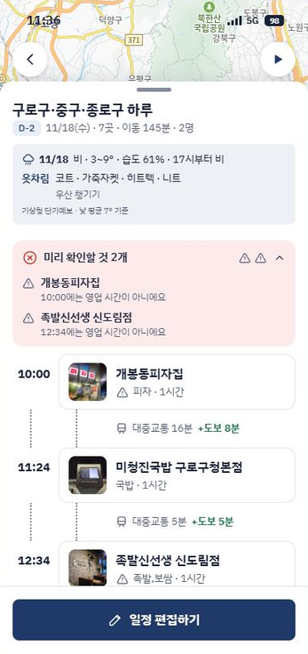
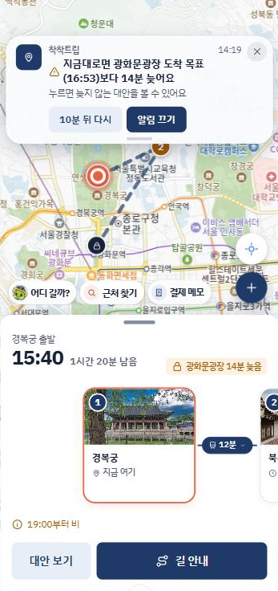
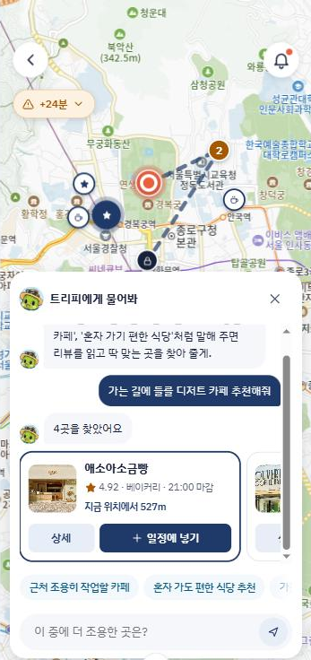
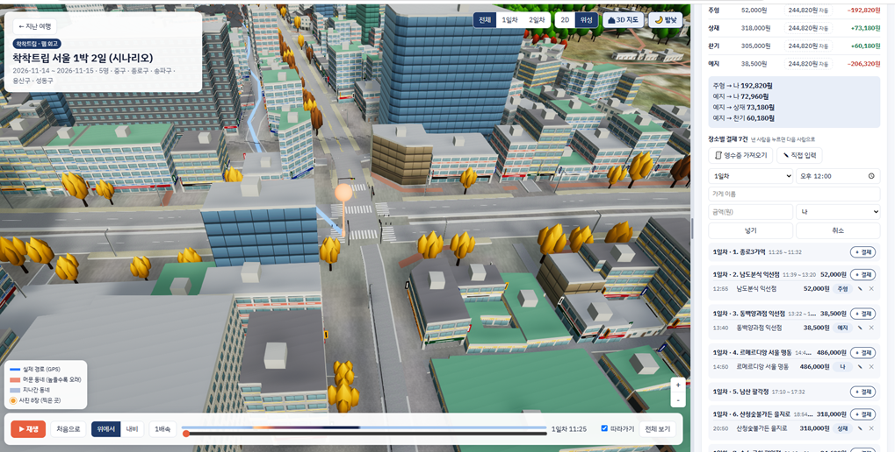

# 착착트립

> 늦어도, 바뀌어도 여행 일정은 착착.

일정을 짤 때부터 여행 중, 다녀온 뒤까지 여행 비서 트리피가 함께하는 여행 일정 앱입니다.
여행 중에 늦어질 것 같으면 먼저 알려 주고, 지금 위치에서 남은 일정을 다시 계산해 고를 수 있는 대안을 보여 줍니다.

## 프로젝트 개요

| 항목 | 내용 |
|---|---|
| 기간 | 2026.10.06 ~ 2026.12.03 |
| 팀 | 착착크루 (5명) |
| 과정 | LX공간정보아카데미 |
| 지역 | 서울 6개 구 (중구·종로구·용산구·영등포구·강남구·송파구) |

여행 일정은 짤 때보다 여행 중에 더 자주 틀어집니다.
한 곳에서 오래 머물거나 길이 막히면, 뒤에 잡아 둔 예약에 맞추기 위해 그 자리에서 일정을 다시 짜야 합니다.
착착트립은 이 "그 자리에서 다시 짜기"를 앱이 대신 계산해 주는 것을 목표로 만들었습니다.

## 주요 기능

### 여행 전

<table>
  <tr>
    <th>AI 여행 일정 생성</th>
    <th>일정 점검</th>
  </tr>
  <tr>
    <td align="center"></td>
    <td align="center"></td>
  </tr>
  <tr>
    <td>지역·날짜·출발지·동행·가고 싶은 곳의 종류·이동 수단을 단계별로 고르면 AI가 장소를 고르고 하루 동선을 짜 줍니다.<br>SNS 링크로 가고 싶은 곳을 담거나 예약 캡처를 올리면 Gemini가 장소·시간을 읽고, 사용자가 확인한 뒤에 일정에 넣습니다.</td>
    <td>짠 일정을 실제 대중교통·도보 시간과 영업시간으로 다시 계산해 "미리 확인할 것"으로 알려 줍니다.<br>그날 날씨와 옷차림, 우산이 필요한 시간도 함께 보여 줍니다.</td>
  </tr>
</table>

### 여행 중

<table>
  <tr>
    <th>여행 중 일정 관리</th>
    <th>AI 장소 검색</th>
  </tr>
  <tr>
    <td align="center"></td>
    <td align="center"></td>
  </tr>
  <tr>
    <td>위치로 도착·출발을 알아서 기록하고, 다음 예약에 늦을 것 같으면 "14분 늦어요"처럼 먼저 알려 줍니다.<br>[대안 보기]를 누르면 지금 위치에서 남은 일정을 다시 계산한 대안을 고를 수 있습니다.</td>
    <td>"가는 길에 들를 디저트 카페"처럼 말로 물으면 트리피가 조건에 맞는 장소를 찾아 줍니다.<br>평점·마감 시간·거리를 보고 바로 일정에 넣을 수 있습니다.</td>
  </tr>
</table>

### 여행 후



**여행 회고**
다녀온 길을 3D 지도 위에 다시 재생해 하루를 돌아볼 수 있습니다.
실제 GPS 경로, 오래 머문 곳, 사진 찍은 곳을 함께 보여 줍니다.

**사진·결제 관리**
여행 사진을 앨범과 요약 영상으로 정리합니다.
영수증을 올리면 Gemini가 가게·금액을 읽고, 사용자가 확인한 뒤에 결제 내역에 넣습니다. 누가 누구에게 얼마를 보내면 되는지 정산도 계산해 줍니다.

## 기술 스택

| 구분 | 기술 |
|---|---|
| Frontend | Vue 3.5, Vite 8, Pinia 4, Vue Router 5, Kakao Map, MapLibre GL 6, Unity 6 WebGL |
| 앱 | Capacitor 8 (같은 Vue 화면을 Android 앱으로 감쌈) |
| Backend | Java 17, Spring Boot 4.0, Spring Security, MyBatis, Spring AI 2.0, JSqlParser 5.3 |
| Database | PostgreSQL 17, PostGIS 3.5, pgvector |
| AI | Gemini 3.8 Flash, Gemini Embedding 001 |
| 외부 API | 카카오 지도·로컬, TMAP, ODsay, TourAPI, 기상청 단기예보 |
| 배포 | Docker Compose, Nginx |

## 시스템 구성

```
브라우저 ──▶ web (Nginx :80) ──/api──▶ backend (Spring Boot :8080) ──▶ db (PostgreSQL :5432)
              화면 파일 제공                Gemini · 지도 · 길찾기 · 날씨 API 호출
```

브라우저는 Nginx(web)만 거치고, `/api` 요청은 Nginx가 Spring Boot 서버로 넘깁니다.
밖으로 열리는 것은 web 하나이고, 서버와 DB는 도커 내부 네트워크에서만 연결됩니다.

## 핵심 구현

**자연어 공간 검색**
Gemini가 질문을 SQL로 바꾸면 JSqlParser로 검사해 SELECT만 통과시킵니다. 장소·리뷰 뷰만 읽을 수 있는 전용 계정으로, 3초 제한을 걸고 실행합니다.
"조용한", "분위기 좋은" 같은 조건은 리뷰 임베딩(pgvector, 768차원)으로 비슷한 리뷰를 찾아 반영합니다. 결과는 실제 도보 경로 기준으로 다시 정렬합니다.

**도착·출발 판정**
일반 장소는 반경으로 판정합니다 (도착 150m 안, 출발 200m 밖).
공원처럼 넓은 장소는 PostGIS 경계 폴리곤과의 거리로 판정합니다 (경계에서 30m 안이면 도착, 80m 밖이면 출발).

**지연 감지·대안**
현재 위치, 지금 장소에 머문 시간, 실제 이동 시간으로 다음 예약 도착 시각을 예측합니다.
늦을 것 같으면 대안 3가지(머무는 시간 줄이기, 한 곳 빼기, 다른 곳으로 바꾸기)를 만들고, 대안마다 예약 앞 여유 시간을 보여 줍니다.

**AI 일정 생성**
Gemini가 장소를 고르면 규칙으로 영업시간·거리를 다시 검사합니다.
동선은 최근접 이웃으로 순서를 잡고 2-opt로 꼬인 구간을 풉니다. 서울 생활인구를 250m 격자로 나눠 시간대별 혼잡도를 반영합니다.

**3D 회고**
DEM 지형 위에 건물·도로 면을 올려 3D 지도를 만듭니다.
버스·택시 구간은 GPS 점을 찻길에 맞추는 맵 매칭으로 다시 그립니다.

## 팀원

| 이름 | 역할 | 담당 |
|---|---|---|
| 김주형 | 팀장 | AI 여행 일정 생성, 예약·영수증 캡처 인식, SNS 링크 장소 추출 |
| 박석진 | 부팀장 | 여행 회고·3D 지도, 사진 앨범·요약 영상, 결제·정산 |
| 이찬기 | 팀원 | 일정 관리·점검, 생활인구 혼잡도 분석, 장소 선정 규칙 |
| 신예지 | 팀원 | 여행 중 일정 관리, AI 장소 검색, Git 협업·배포 환경 |
| 이상재 | 팀원 | 공통 DB 설계, 장소·리뷰·공공데이터 구축, 회원·일정 공유 |

## 실행 방법

Docker가 설치돼 있으면 아래 명령으로 DB·서버·화면을 한 번에 켭니다.

```
cp .env.example .env
docker compose --profile app up -d --build
```

브라우저에서 http://localhost 를 엽니다. 처음 켤 때는 DB 데이터를 넣느라 몇 분 걸립니다.

- 테스트 계정: `tripuser` / `tripuser1234` (`db/90_test_data.sql`)
- API 키가 없어도 서버는 켜집니다. 키가 없는 기능은 규칙·추정 값으로 대신 동작합니다.
- 3D 회고는 유니티 빌드 파일(`frontend/public/unity3d/`)이 필요합니다. 크기가 커서 저장소에는 넣지 않았습니다.
- 개발 환경 설정은 [docs/SETUP.md](docs/SETUP.md)를 참고하세요.

## 문서

| 문서 | 내용 |
|---|---|
| [docs/API.md](docs/API.md) | API 주소·요청·응답 |
| [docs/DB.md](docs/DB.md) | 테이블 목록과 컬럼 |
| [docs/DEMO.md](docs/DEMO.md) | 시연 흐름 |
| [docs/DECISIONS.md](docs/DECISIONS.md) | 팀에서 정한 것 |

## 데이터 출처

| 데이터 | 출처 |
|---|---|
| 서울 생활인구 | 서울 열린데이터광장 (공공누리 제1유형) |
| 관광지 정보 | 한국관광공사 TourAPI |
| 날씨 | 기상청 단기예보 조회서비스 |
| 지도·장소 검색 | 카카오 지도·로컬 API |
| 지형 높이 | Terrain Tiles (SRTM 등) |
| 장소·리뷰 일부 | 네이버 지도 (프로토타입 시연용) |
